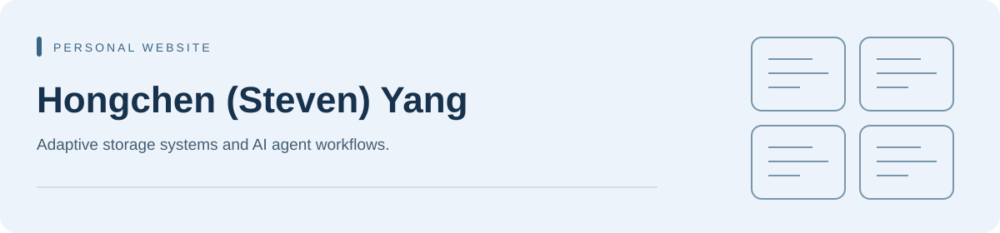

# Hongchen (Steven) Yang

[Visit website](https://steventimes.github.io) · [Develop](#local-development) · [Content](#content-and-structure) · [Checks](#verification)

I'm a computer science student at Brandeis University. I study adaptive storage
systems and build AI agent workflows.

[Visit my website](https://steventimes.github.io) for my research, published
paper, internships, public projects, résumé, and contact details.

## Local development

The site uses Astro and TypeScript. Use Node.js `^22.19.0 || >=24.0.0` and
npm 9.6.5 or newer, as specified in `package.json`.

```bash
npm ci
npm run dev
```

The development server prints its local address. To inspect a production build:

```bash
npm run build
npm run preview
```

## Content and structure

| Location | Purpose |
| --- | --- |
| [src/data/site.ts](src/data/site.ts) | Shared site content |
| [src/components/](src/components/) | Research, publications, experience, projects, and contact sections |
| [src/pages/index.astro](src/pages/index.astro) | Home page composition |
| [src/styles/global.css](src/styles/global.css) | Shared styles |
| [public/](public/) | Static public assets |

Keep biographical claims, publication details, project links, and résumé content
consistent when editing the site.

## Verification

```bash
npm run verify
npm run test:ui
```

`verify` runs Astro/TypeScript checks, unit tests, and a production build.
`test:ui` runs the separate Playwright browser checks and needs its browser
runtime. Local checks do not publish the website.
